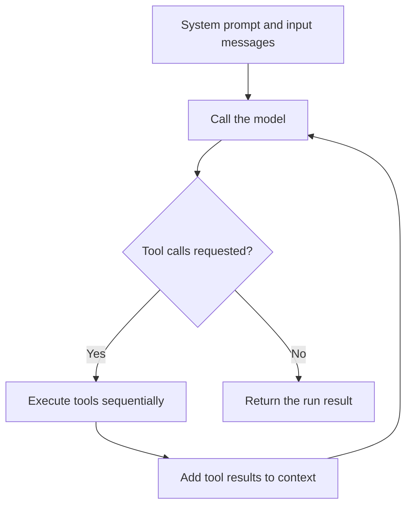

# Core concepts

Six components cover the main ideas in Lighter: `Provider`, `Model`, `Agent`, `Message`, `Tool`, and `Hook`.

## From model to agent

| Component | Responsibility | When to use it |
| --- | --- | --- |
| Provider | Talks to a model service and converts requests, responses, and errors | Choose OpenAI, Claude, DeepSeek, or connect another service |
| Model | Wraps a provider and runs hooks before and after model calls | Create an agent or make a single model call |
| Agent | Organizes messages and runs the model–tool loop | Let a model use tools to complete tasks |

An Agent uses one Model, and a Model uses one Provider. Built-in providers take an API key and model ID, then are passed to Model:

```ts
import { Agent, Model, OpenAIProvider } from "@yong_xie/lighter";

// Compose the three components. No request is sent during construction.
const provider = new OpenAIProvider(
  process.env.OPENAI_API_KEY!,
  process.env.OPENAI_MODEL!,
);
const model = new Model(provider);
const agent = new Agent({ model });
```

## What happens during a run

When you call `agent.run({ messages })`, the agent:

1. Combines its system prompt and the input messages into context.
2. Calls the model to obtain an assistant message.
3. If the message includes tool calls, executes them sequentially, adds the results to context, and calls the model again.
4. If there are no tool calls, ends the loop and returns the messages added during this run.



Without tools, a normal run calls the model once. If the model keeps requesting tools, the loop continues. There is currently no built-in maximum number of rounds.

## Messages, tools, and hooks

A **Message** carries context: system instructions, user input, assistant replies, or tool results. Assistant messages can include tool calls, so they are not always text intended for the user.

A **Tool** is a function the model can call. You define its name, description, parameter schema, and execution logic. Agent handles the call and passes the result back.

A **Hook** runs at the start or end of a run, or before or after a model call. Use hooks to log activity or modify requests and replies.

## Runs and conversations

A single `run()` may contain multiple model calls, but it does not automatically remember earlier runs. Your application must save conversation history and pass it into the next request.

`run()` and `stream()` share the same core loop. The former waits for the final result; the latter yields incremental text while running, followed by the complete result.

[← Quickstart](quickstart.md) · [Next: configure an agent →](../guides/configuration.md)
