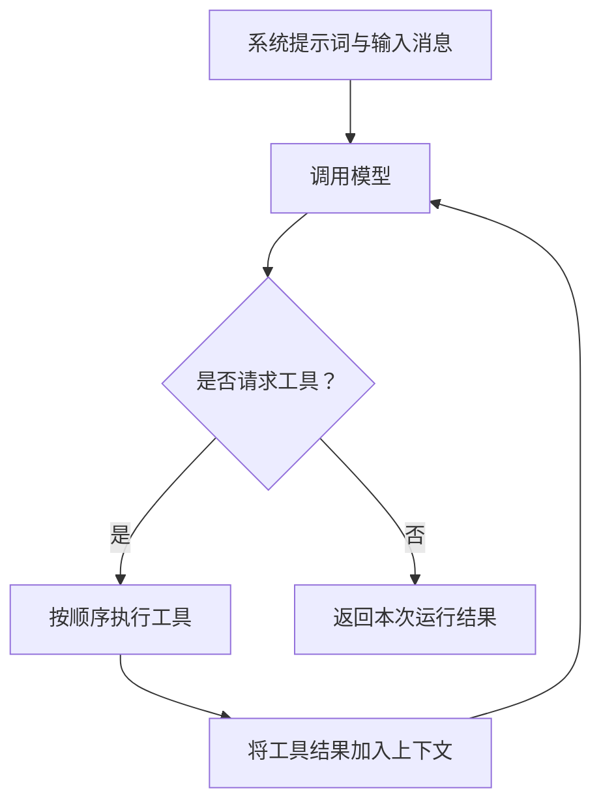

# 核心概念

理解六个组件，就能掌握 Lighter 的主要用法：`Provider`、`Model`、`Agent`、`Message`、`Tool` 和 `Hook`。

## 从模型到 Agent

| 组件 | 负责什么 | 什么时候使用 |
| --- | --- | --- |
| Provider | 与具体模型服务通信，转换请求、响应和错误 | 选择 OpenAI、Claude、DeepSeek，或接入其他服务 |
| Model | 封装 Provider，执行模型调用前后的钩子 | 创建 Agent，或直接调用一次模型 |
| Agent | 组织消息，执行模型和工具之间的循环 | 让模型借助工具完成任务 |

一个 Agent 使用一个 Model，一个 Model 使用一个 Provider。内置 Provider 接收 API key 和模型 ID，再交给 Model：

```ts
import { Agent, Model, OpenAIProvider } from "@yong_xie/lighter";

// 三个组件依次组合；此时只创建对象，还没有发送请求。
const provider = new OpenAIProvider(
  process.env.OPENAI_API_KEY!,
  process.env.OPENAI_MODEL!,
);
const model = new Model(provider);
const agent = new Agent({ model });
```

## 一次运行发生了什么

调用 `agent.run({ messages })` 后，Agent 会：

1. 将系统提示词与输入消息组成上下文。
2. 调用模型，获得助手消息。
3. 如果消息包含工具调用，按顺序执行工具，把结果加入上下文，再次调用模型。
4. 如果消息没有工具调用，结束循环，返回本次新增的消息。



没有配置工具时，正常情况下只会调用一次模型。模型持续请求工具时，循环会继续；当前没有内置最大轮数。

## 消息、工具与钩子

**Message** 承载上下文，包括系统指令、用户输入、助手回复和工具结果。助手消息也可能包含工具调用，并不总是一段面向用户的文本。

**Tool** 是交给模型调用的函数。你定义名称、描述、参数格式和执行逻辑，Agent 负责处理调用与结果回传。

**Hook** 在运行开始、模型调用前后或运行结束时执行，适合记录日志或修改请求与回复。

## 一次运行与多轮对话

一次 `run()` 可以包含多次模型调用，但不会自动记住上一次运行。多轮对话需要应用保存历史，在下一次请求时重新传入。

`run()` 与 `stream()` 使用相同的核心循环：前者等待最终结果，后者在运行中提供增量文本，最后再提供完整结果。

[← 快速开始](quickstart.md) · [下一步：配置 Agent →](../guides/configuration.md)
